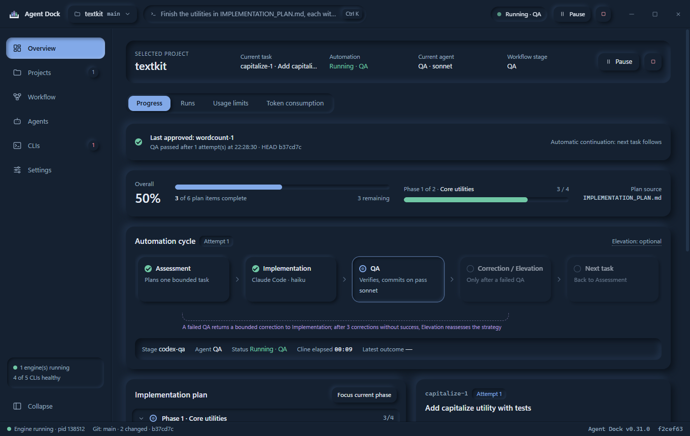
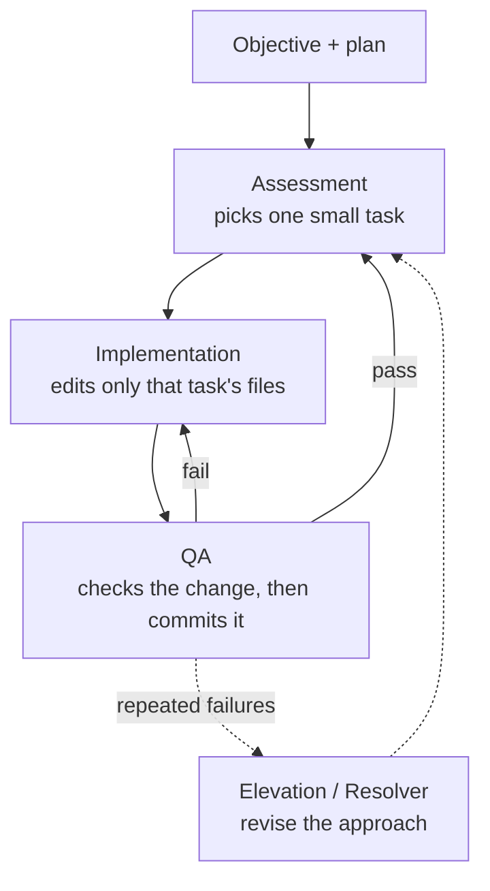

  

<h1 align="center">Agent Dock</h1>

  A Windows desktop app that runs AI coding agents on your projects, one small, reviewed change at a time.

  
  
  

  

## What it does

- **Works through your plan for you.** Point Agent Dock at a Git repository and an objective (or let
  it draft an `IMPLEMENTATION_PLAN.md`). It picks one small task, has an agent make the change, has
  another agent review it, and commits only what passes.
- **Uses the agents you already have.** Codex CLI or Claude Code plan and review; Codex CLI, Claude
  Code, OpenCode or Cline implement, on cloud models or local ones through llama.cpp or Ollama.
  Each role can use its own CLI and model.
- **Shows everything in one place.** Progress per task, run history and reports, your plan's usage
  limits as the CLIs report them, and token use per project.
- **Can run unattended.** Hard caps on tasks, hours, corrections, tokens and spend, plus a
  Supervisor that alerts you, pauses or stops when a run stalls or keeps failing.

## How the loop works

Assessment reads the plan and the code and chooses the next task, with the files it may touch and a
check command. Implementation makes the change inside those files only. QA runs the check, reviews
the diff and commits it, or sends it back with what to fix. When a task keeps failing, a stronger
model (Elevation) revises the strategy, and Resolver helps with blocked tasks. You can add your own
review steps (workflow roles), such as a second-opinion QA on another CLI.

## Install

1. Download `AgentDock-Setup-<version>-win-x64.exe` from the
   [latest release](https://github.com/ProjktRed/Agent-Dock/releases/latest) and run it. It installs
   for your Windows account only (no admin rights), with Start menu and desktop shortcuts and an
   uninstaller.
2. The installer is not code-signed yet, so Windows SmartScreen may warn about an unknown publisher.
   Choose **More info › Run anyway**. Each release's notes list the installer's SHA-256 if you want
   to check the file first.
3. **Linux (preview):** download `AgentDock-<version>-linux-x86_64.AppImage` from the same release,
   make it executable (`chmod +x`) and run it. It updates itself from signed releases like the
   Windows app. Windows remains the main platform.

**You need:** Windows 10 or 11, [Git](https://git-scm.com/download/win), and at least one agent CLI,
installed and signed in: [Codex CLI](https://github.com/openai/codex) or
[Claude Code](https://docs.anthropic.com/en/docs/claude-code). Agent Dock never handles their logins.
For local models, add Cline or OpenCode with [llama.cpp](https://github.com/ggml-org/llama.cpp) or
[Ollama](https://ollama.com).

## Getting started

1. **Setup** opens on first launch. It finds the CLIs and local model servers installed on your
   computer and points the agents at them. **Detect again** picks up anything you install later; a
   local model is never assumed, so choose it in **Agents**.
2. **Add a project:** an existing Git repository, a GitHub clone or a new folder. Give it an
   objective, or let **Create plan with a model** write a plan for you to review.
3. **Start** it on **Overview** and follow along under **Progress**. Finished runs and their reports
   are under **Runs**.

## You stay in control

- Nothing runs until you press **Start**. Pause, Stop and Stop now work at any time, and **Stop all**
  (Settings › Safety, the tray menu, or a terminal command) stops every project at once.
- Agents cannot commit, rewrite Git history or touch files outside their task. Only QA commits, and
  only a change that passed its checks.
- **Protected paths** (Settings › Safety; `.git/`, `.env*` and `secrets/` by default) and Agent
  Dock's own folders are off limits to every agent.
- API keys you enter are encrypted with your Windows account and kept out of logs, prompts,
  notifications and diagnostics.
- Every action is written to a tamper-evident log per project that you can verify.

These guards are not an operating-system sandbox: the project's own scripts still run as you. See
[docs/security.md](docs/security.md) for the details.

## Updates

Agent Dock checks for new releases and offers to install them. It installs one only when the
release is signed with the Agent Dock release key and the download matches its signed manifest.

## Troubleshooting

- **Something went wrong?** Settings › Advanced › **Export diagnostics** saves a zip with versions,
  settings and engine logs, leaving out secrets, your code and model prompts. Attach it to an
  [issue](https://github.com/ProjktRed/Agent-Dock/issues).
- **A CLI shows "Sign-in required".** Sign in once in a terminal (`codex login` or `claude`), then
  **Test** it under CLIs.
- **Start says to choose a model.** Pick the Implementation agent's local model in **Agents**; the
  list comes from llama.cpp or Ollama (CLIs › Models › Refresh).
- **Runs stop with `EPERM` errors.** Antivirus or indexing is locking files. Agent Dock retries for
  a few seconds; if it keeps happening, exclude `%APPDATA%\Agent Dock\projects` from real-time
  scanning.

## Documentation

- [User guide](docs/user-guide.md): getting started, task sizes, unattended runs and troubleshooting
- [How it works](docs/how-it-works.md): where each number comes from, roles, limits, backups and known limitations
- [Architecture](docs/architecture.md): source layout and how settings map to engine flags
- [Security boundaries](docs/security.md): what the guards do and do not protect against
- [Building and releasing](docs/building.md): running from source and the release process
- [Engine](engine/ENGINE_README.md): the automation engine on its own, with its flags

## Contributing

Bug reports and pull requests are welcome: see [CONTRIBUTING.md](CONTRIBUTING.md). Report security
problems privately as described in [SECURITY.md](SECURITY.md). Contributors are listed in
[AUTHORS](AUTHORS).

## License

[MIT](LICENSE)
